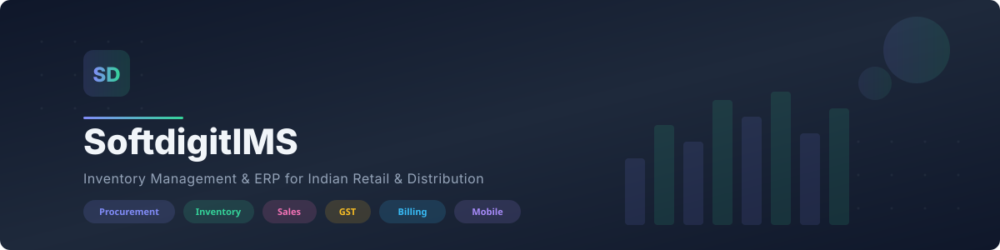
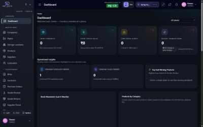
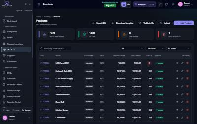
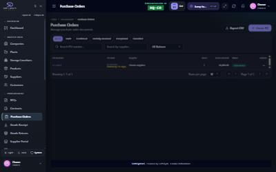
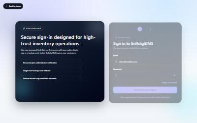

<p align="center">
  
</p>

<p align="center">
  <a href="https://github.com/Tharun-code-08/Inventory-control/actions/workflows/ci.yml"></a>
  <a href="https://github.com/Tharun-code-08/Inventory-control/actions/workflows/deploy.yml"></a>
  <a href="https://github.com/Tharun-code-08/Inventory-control/actions/workflows/codeql.yml"></a>
  
  <a href="LICENSE"></a>
</p>

<p align="center">
  <b>Production-grade inventory management and ERP for Indian retail and distribution businesses.</b><br/>
  Procurement · Inventory · Sales · GST · Billing · Mobile · WhatsApp — all in one multi-tenant platform.
</p>

<p align="center">
  <a href="#-screenshots">Screenshots</a> · <a href="#-key-features">Features</a> · <a href="#-tech-stack">Tech Stack</a> · <a href="#-architecture">Architecture</a> · <a href="#-getting-started">Getting Started</a> · <a href="#-security">Security</a> · <a href="docs/README.md">Docs</a>
</p>

---

## Screenshots

<p align="center">
  
  <br/><sub><b>Dashboard</b> — Real-time KPIs, stock movement charts, top-selling products, and operational insights</sub>
</p>

<br/>

<p align="center">
  
  <br/><sub><b>Products</b> — Master data management with bulk CSV import, validation, and category-based organization</sub>
</p>

<br/>

<p align="center">
  
  <br/><sub><b>Purchase Orders</b> — End-to-end procurement workflow from RFQ to goods receipt</sub>
</p>

<br/>

<p align="center">
  
  <br/><sub><b>Secure Login</b> — Two-step authentication with TOTP-based multi-factor verification</sub>
</p>

---

## Key Features

### Procurement
- **Supplier Management** — Maintain supplier master, contact history, and performance
- **RFQ & Supplier Portal** — Send RFQs, receive bids through a dedicated supplier portal, and compare quotes side-by-side
- **Purchase Orders** — Create, approve, and track POs with multi-level approval workflows
- **Goods Receipts** — Receive stock against POs, handle partial deliveries and quality holds
- **Supplier Bills & Payments** — Record invoices, match with GRNs, track payment status

### Inventory
- **Transaction-safe Stock Ledger** — Stock balances maintained by PostgreSQL triggers; negative stock is rejected at the database level
- **Multi-plant / Multi-warehouse** — Manage stock across plants, storage locations, and transfer between them
- **Batch & Serial Tracking** — Batch/serial numbers, expiry dates, FEFO (First Expired, First Out) picking
- **Stock Counts & Adjustments** — Cycle counts, full inventory counts, and variance reconciliation
- **Smart Alerts** — Low-stock, reorder-point, dead-stock, and expiry warnings

### Sales & Finance
- **Sales Quotations** — Quote builder with a customer review portal for online acceptance
- **Sales Orders & Invoices** — Order-to-invoice flow with branded PDF documents
- **GST-compliant Documents** — CGST/SGST/IGST auto-split, HSN codes, configurable number series, e-way bill records
- **Receipts, Returns & Credit Notes** — Full refund and return cycle

### Reporting & Analytics
- **Dashboard KPIs** — Revenue, stock value, pending orders, top-moving products
- **Stock Reports** — Movement history, valuation (FIFO/weighted average), dead stock analysis
- **Profitability Analysis** — Margin reports, product-level and category-level breakdowns
- **Excel Exports** — One-click export for any data view

### Platform & Security
- **Multi-tenant Isolation** — Row-level security in PostgreSQL; each organisation's data is fully isolated
- **Role-based Access** — Granular permissions per role — Owner, Admin, Manager, Staff, Warehouse, Viewer
- **MFA (TOTP)** — Time-based one-time passwords with backup codes
- **AES-256-GCM Encryption** — Secrets at rest (SMTP passwords, MFA keys, backup tokens) encrypted with HKDF-derived keys
- **Audit Log** — Every sensitive action is tracked with who, what, and when
- **Automated Backups** — Per-company backups to local storage, email, or Google Drive

### Mobile & Integrations
- **Expo Mobile App** — Barcode scanning, stock counts, goods receipts/issues, and approvals on the warehouse floor
- **WhatsApp Assistant** — Check stock levels, look up products, and draft documents from WhatsApp
- **Razorpay Billing** — Trial to paid plan conversion, subscription management, renewal dunning
- **Email (SMTP)** — Send documents and notifications from each organisation's own verified sender

---

## Tech Stack

| Layer | Technology |
| :--- | :--- |
| **API** | [NestJS](https://nestjs.com) 12 · TypeScript · [Prisma](https://www.prisma.io) 7 |
| **Database** | PostgreSQL 15+ with RLS and stock triggers |
| **Cache & Jobs** | Redis 7 · [BullMQ](https://docs.bullmq.io) 6 |
| **Web** | React 19 · Vite 8 · Tailwind CSS 4 · TanStack Query 5 |
| **Mobile** | Expo 54 · React Native 0.81 · Expo Router |
| **Documents** | Puppeteer HTML-to-PDF |
| **Payments** | Razorpay |
| **Testing** | Jest 30 (840+ tests) · Vitest · Playwright |
| **CI/CD** | GitHub Actions · SSH deploy with automatic rollback |

---

## Architecture

```
                    ┌──────────────────┐
                    │   Web (React)    │
                    └────────┬─────────┘
                             │
┌──────────────┐    ┌────────▼─────────┐    ┌─────────────────────────────────┐
│ Mobile (Expo)├────►  REST API /api/v1 ├────►  PostgreSQL                     │
└──────────────┘    │   (NestJS)       │    │  · Row-level security           │
                    └───┬──┬──┬──┬─────┘    │  · Stock triggers               │
┌──────────────┐        │  │  │  │          │  · Concurrency-safe sequences   │
│  WhatsApp    ├────────┘  │  │  │          └─────────────────────────────────┘
└──────────────┘           │  │  │
                    ┌──────▼──┘  │
                    │ Redis +    │
                    │ BullMQ     │   ┌──────────────────────┐
                    └────────────┘   │ External Services    │
                                     │ · SMTP (email)       │
                                     │ · Razorpay (billing) │
                                     │ · Google Drive       │
                                     │ · Push notifications │
                                     │ · Puppeteer (PDFs)   │
                                     └──────────────────────┘
```

**Key design decisions:**
- Stock movements and balances commit atomically — the database rejects negative stock
- Document numbers use per-organisation, concurrency-safe sequences
- Organisations are isolated by row-level security and service-level checks
- Background work (reminders, dunning, exports) runs on BullMQ

---

## Repository Layout

```
.
├── apps/
│   ├── api/            NestJS API — modules, Prisma schema, migrations, e2e tests
│   ├── web/            React SPA — pages, components, hooks, Playwright e2e
│   └── mobile/         Expo warehouse app — routes, components
├── packages/
│   └── shared-types/   Types shared between API and clients
├── deploy/             PM2, nginx, PostgreSQL backup scripts, systemd timers
├── docker/             docker-compose (Postgres + Redis), API Dockerfile
├── docs/               Deployment, runbook, backups, testing guides
├── scripts/            Setup, deploy, health checks
└── .github/            CI workflows, Dependabot, CODEOWNERS, PR templates
```

---

## Getting Started

### Prerequisites

- **Node.js 22.19+** and npm 10+
- **Docker** (for local PostgreSQL and Redis), or your own PostgreSQL 15+ and Redis 7

### Quick Start

```bash
# 1. Clone and install
git clone https://github.com/Tharun-code-08/Inventory-control.git
cd Inventory-control
npm install

# 2. Start databases
npm run docker:deps

# 3. Generate secrets and configure
npm run setup:credentials

# 4. Create schema and seed data
cd apps/api
npx prisma migrate deploy
npm run db:seed
cd ../..

# 5. Run the app
npm run dev
```

The web app opens at **http://localhost:5173** and the API at **http://localhost:3000**.
API docs (Swagger) are at http://localhost:3000/api/docs.

> **Windows users:** `npm run setup:new-machine` runs a PowerShell script that automates steps 2-5.

---

## Configuration

The API reads `apps/api/.env` (never committed). Key variable groups:

| Variables | Purpose |
| :--- | :--- |
| `DATABASE_URL`, `REDIS_HOST/PORT` | Database and cache |
| `JWT_SECRET`, `REFRESH_SECRET`, `COOKIE_SECRET` | Session signing |
| `SUPPLIER_PORTAL_SECRET` | Signs supplier portal links |
| `SMTP_CREDENTIALS_KEY` | Encrypts organisation SMTP passwords |
| `SMTP_*`, `MAIL_FROM` | Platform email |
| `RAZORPAY_KEY_ID/SECRET/WEBHOOK_SECRET` | Payment integration |
| `WEB_ORIGIN`, `PUBLIC_WEB_URL` | CORS and email links |

See `apps/api/.env.example` for the full list with descriptions.

---

## Everyday Commands

| Command | Description |
| :--- | :--- |
| `npm run dev` | API + web in watch mode |
| `npm run build` | Build all packages |
| `npm run lint` | ESLint across the monorepo |
| `npm test` | API unit tests + web tests |
| `npm run test:workflows` | API business-workflow e2e tests |
| `npm run test:playwright` | Web end-to-end tests (Playwright) |
| `npm run check:bundle-budget` | Verify web bundle size limits |
| `npm run dev:mobile` | Start Expo dev server |

---

## Testing

CI runs automatically on every pull request:

| Check | What it verifies |
| :--- | :--- |
| **Quality Gate** | Lint, type checks, builds, bundle budget |
| **Unit Tests** | 840+ Jest tests (API) + Vitest (web) |
| **Business Workflows** | End-to-end flows against fresh PostgreSQL + Redis |
| **Playwright** | Web UI flows on a mobile viewport |
| **CodeQL** | Static security analysis |
| **ShellCheck** | Shell script safety |

---

## Security

Security is a first-class concern:

- **Multi-tenant isolation** — PostgreSQL row-level security and service-level shop checks
- **AES-256-GCM encryption** — Secrets at rest encrypted with HKDF-derived keys
- **HMAC-SHA256 portal tokens** — Timing-safe verification for supplier and customer portals
- **Rate limiting** — Throttle decorators on all public endpoints
- **Helmet** — HTTP security headers (HSTS, CSP, X-Frame-Options)
- **MFA** — TOTP with backup codes
- **CodeQL** — Automated static analysis on every PR
- **No secrets in code** — All credentials via environment variables

Report vulnerabilities privately as described in [SECURITY.md](SECURITY.md).

---

## Deployment

Production deploys are automatic: when CI passes on `main`, the deploy workflow SSHes to the server, runs migrations, restarts under PM2, and verifies health. A failed health check **rolls back** to the previous release.

- [Deployment Guide](docs/DEPLOYMENT.md) · [Production Runbook](docs/RUNBOOK.md) · [Backup & Recovery](docs/postgres-backup-recovery.md)

---

## Contributing

`main` is always deployable. Work on a short-lived branch (`feat/`, `fix/`, `chore/`, `docs/`), open a PR, and squash-merge once CI passes. See [CONTRIBUTING.md](CONTRIBUTING.md).

---

## License

Copyright &copy; 2026 Tharun-code-08 and contributors.

Licensed under the [GNU Affero General Public License v3.0](LICENSE) (`AGPL-3.0-only`).
You may use, study, modify, and share the code. If you distribute it or host a modified version as a service, you must make your source available under the same license.
